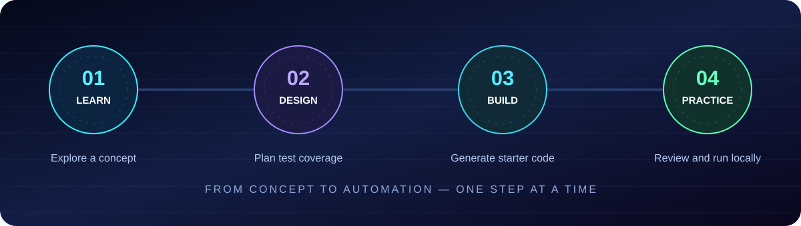
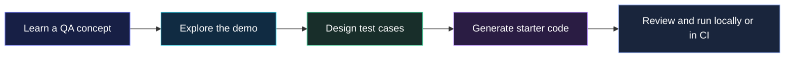

<div align="center">



<p>
  <a href="https://github.com/SanFlash/Satyo-mate/actions"></a>
  <a href="https://github.com/SanFlash/Satyo-mate/commits/main"></a>
  <a href="https://github.com/SanFlash/Satyo-mate/issues"></a>
  <a href="https://github.com/SanFlash/Satyo-mate/stargazers"></a>
  
  
</p>

### 

**A hands-on lab for learning, designing, and preparing QA automation.**

[🚀 Explore the project](https://github.com/SanFlash/Satyo-mate) · [🐛 Report a bug](https://github.com/SanFlash/Satyo-mate/issues/new) · [💡 Suggest a feature](https://github.com/SanFlash/Satyo-mate/issues)


</div>

## ✦ The idea

QA Nexus turns QA learning into a practical workflow: **learn a concept → explore an example → design tests → generate a starter framework.**

> [!NOTE]
> This is a learning and code-generation workspace. The hosted app does **not** execute real Playwright or Selenium browser sessions. Review and run generated code in your own local or CI environment.

<details>
<summary><strong>🧭 Explore this README</strong> · click to expand</summary>

| Area | Jump in |
|---|---|
| ✨ Product highlights | [Explore features](#-product-highlights) |
| 🧰 Workspaces | [See the workspaces](#-your-qa-workbench) |
| 🏗️ Workflow | [How it fits together](#-the-qa-nexus-workflow) |
| 💻 Setup | [Run locally](#-run-it-locally) |
| 🧪 Guides | [Use the tools](#-interactive-guides) |
| 🗺️ Roadmap | [What comes next](#️-roadmap) |
| 👤 Creator | [Meet the creator](#-creator) |

</details>

## ✨ Product highlights

<table>
<tr>
<td width="50%" valign="top">

<h3>📚 Learn by exploring</h3>


- Browse a curated QA automation curriculum.
- Search topics, filter by difficulty, and bookmark lessons.
- Explore local demos for forms, dropdowns, dialogs, tables, tabs, and more.
- Track learning progress in your browser.
- Open the command palette with `Ctrl+K` / `⌘K`.

</td>
<td width="50%" valign="top">

<h3>🧪 Design better tests</h3>


- Create and edit test cases, steps, preconditions, and expected results.
- Assign priorities and execution statuses.
- Search your test inventory and review coverage.
- Export a JSON backup or CSV test matrix.
- Generate Playwright/Selenium starter snippets.

</td>
</tr>
<tr>
<td width="50%" valign="top">

<h3>🧱 Assemble a framework</h3>


- Select an automation tool and language.
- Configure the project name and base URL.
- Search a library of reusable actions.
- Preview, copy, and download starter files.

</td>
<td width="50%" valign="top">

<h3>⚡ Designed for practice</h3>


- Contextual tooltips and quick navigation.
- Workspace backup and restore.
- Responsive desktop, tablet, and mobile layouts.
- Motion preferences that respect `prefers-reduced-motion`.

</td>
</tr>
</table>

## 🧰 Your QA workbench

<div align="center">

| Workspace | Route | Use it to |
|:--|:--:|:--|
| **Learning Dashboard** | `/` | Study concepts, explore demos, and save progress |
| **Test Design Studio** | `/test-studio` | Build test cases, assess planning coverage, and export |
| **Framework Builder** | `/framework-builder` | Configure and download a starter Page Object Model |

</div>

## 🏗️ The QA Nexus workflow

<div align="center">



</div>



## 🛠️ Built with

<div align="center">


<br/>


</div>

## 💻 Run it locally

<details open>
<summary><strong>01 · Clone the repository</strong></summary>

```bash
git clone https://github.com/SanFlash/Satyo-mate.git
cd Satyo-mate
```

</details>
<details>
<summary><strong>02 · Install dependencies</strong></summary>

Requires Node.js 20+ and npm.

```bash
npm install
```

</details>
<details>
<summary><strong>03 · Start the development server</strong></summary>

```bash
npm run dev
```

Open [http://localhost:3000](http://localhost:3000).

</details>
<details>
<summary><strong>04 · Validate before contributing</strong></summary>

```bash
npm run typecheck
npm run build
```

</details>

## 🧪 Interactive guides

<details>
<summary><strong>📘 Learning Dashboard — learn and revisit</strong></summary>

1. Search or filter the curriculum.
2. Select a lesson to read the guide and explore the local demo.
3. Bookmark topics you want to revisit.
4. Use `Ctrl+K` / `⌘K` for quick navigation.
5. Export a workspace backup when you want to preserve or transfer your local progress.

Progress and bookmarks are stored in the current browser unless exported.

</details>

<details>
<summary><strong>🧪 Test Design Studio — plan your coverage</strong></summary>

1. Open `/test-studio`.
2. Create test cases with preconditions, steps, expected results, tags, priority, and status.
3. Search and filter the test inventory.
4. Use the coverage map as a planning aid.
5. Export JSON/CSV or generate a starter scaffold.

Coverage is a planning signal, not proof of full requirements traceability or complete application testing.

</details>

<details>
<summary><strong>🧱 Framework Builder — assemble starter files</strong></summary>

1. Open `/framework-builder`.
2. Select an automation tool and programming language.
3. Enter a project name and target base URL.
4. Search and select reusable actions.
5. Preview, copy, or download the generated Page Object Model scaffold.

Before execution, add real selectors, fixtures, test data, assertions, scenario sequencing, and any missing extension-point implementations.

</details>

## 📁 Project map

```text
src/
├── app/
│   ├── api/health/route.ts
│   ├── framework-builder/page.tsx
│   ├── test-studio/page.tsx
│   ├── globals.css
│   ├── layout.tsx
│   └── page.tsx
├── components/
│   └── brand-intro.tsx
└── lib/
    ├── catalog.ts
    └── generator.ts
docs/
├── qa-nexus-banner.svg
└── qa-nexus-feature-map.svg
public/
└── qa-nexus-logo.svg
```

## 🚀 Deployment

1. Import [the GitHub repository](https://github.com/SanFlash/Satyo-mate) into Vercel.
2. Set the root directory to the repository root.
3. Select the Next.js framework preset.
4. Keep the default build command, `next build`.
5. Deploy the production branch and verify the deployment status.

The current learning starter does not require environment variables. Confirm the actual build status in GitHub Actions and Vercel.

## 🗺️ Roadmap

- [ ] ZIP export for complete generated frameworks
- [ ] Requirement-to-test traceability IDs
- [ ] Execution history and richer report exports
- [ ] More curated end-to-end scenarios
- [ ] Unit tests for generated templates and demo flows
- [ ] Optional cloud-synced progress and saved framework recipes

## 🤝 Contribute to QA Nexus

Found a bug or have an idea?

<p align="center">
  <a href="https://github.com/SanFlash/Satyo-mate/issues/new"></a>
  <a href="https://github.com/SanFlash/Satyo-mate/issues"></a>
</p>

1. Open an issue with context and reproduction steps.
2. Create a focused branch.
3. Run `npm run typecheck` and `npm run build`.
4. Open a pull request with a clear summary and test notes.

## 👤 Creator

<div align="center">


### **Satyendra Kumar Namdeo**

Creator of QA Nexus · QA learning · Test design · Automation engineering

<a href="https://github.com/SanFlash"></a>
<a href="https://github.com/SanFlash/Satyo-mate"></a>

</div>

## ⚠️ Honest project boundaries

- Generated templates are starter examples, not guaranteed production-ready tests.
- Selectors and URLs must match the target application.
- Run real Playwright/Selenium execution locally, in CI, or in a separately isolated browser runner.
- Do not execute arbitrary generated code inside the user-facing page or an unrestricted serverless function.

---

<div align="center">


**QA Nexus** · Learn · Practice · Build · Automate

Made by **Satyendra Kumar Namdeo**

[⬆ Back to repository](https://github.com/SanFlash/Satyo-mate)

</div>
